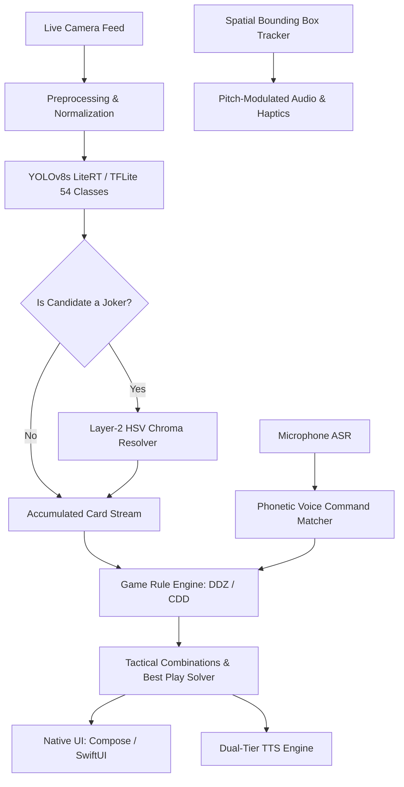

# CDD & DDZ Helper (锄大地 / 斗地主 智能辅助与无障碍助手)


**An Intelligent Computer Vision & Hands-Free Non-Visual Accessible Assistant for Cho Dai Dee (Big Two) and Dou Di Zhu (Fight the Landlord)**

[English](README.md) | [中文说明](README_zh.md)

-blue.svg)


-red.svg)

---

## 📢 Release & Distribution Notice

> [!IMPORTANT]
> **Pre-Release Milestone & Distribution Policy**:
> - **Current Status**: This project is in its official **Pre-release** phase (`v0.1.0-beta`).
> - **Android Distribution**: Pre-built, signed Android APK binaries (`androidApp-release.apk`) are packaged and distributed directly via GitHub Releases for immediate installation, side-loading, and testing on physical Android devices.
> - **iOS Distribution Policy**: The iOS version is **NOT distributed as binary packages (no `.ipa`, no TestFlight public build, and no App Store distribution)** at this stage, as distribution strictly requires an active Apple Developer Program enrollment and App Store review. Instead, **complete native Swift source code, the Xcode project, and a comprehensive local build guide are provided** in this repository. Anyone with a Mac can build and run it locally on iOS Simulators or their personal devices using Xcode.

---

## 🌟 Overview

**CDD & DDZ Helper** is an open-source, on-device AI card game assistant designed for two of the most popular card games in the world:
1. **Cho Dai Dee (锄大地 / Big Two)**: Supports standard 13-card hands with both **Mainland China** and **Hong Kong** rule variations.
2. **Dou Di Zhu (斗地主 / Fight the Landlord)**: Supports **Peasant** (17 cards) and **Landlord** (20 cards) gameplay, including Bombs and Rocket (王炸).

The app combines cutting-edge **edge computer vision (YOLOv8s running on LiteRT / TensorFlow Lite)**, real-time **HSV Chroma ink analysis**, algorithmic **card game rule solvers**, continuous **hands-free trilingual voice control** (Cantonese, Mandarin, English), and **spatial audio/haptic non-visual aiming guidance** tailored for visually impaired players.

---

## ✨ Key Features

### 👁️ Real-Time On-Device Card Detection
- **54-Class YOLOv8s Neural Detector**: Detects all 52 standard playing cards plus the Black Joker (小王) and Red Joker (大王) in real time.
- **Dense Hand & Fan Augmentation**: Trained on synthetically blended, overlapping fanned hands (from 5 to 18+ cards) to reliably identify tightly stacked and partially occluded cards.
- **100% On-Device & Offline**: Powered by Google LiteRT / TFLite float32 models with zero latency and complete privacy—no camera frames or images are sent to any remote server.

### 🛡️ Two-Layer Joker Disambiguation Safeguard
- **The Challenge**: Black Jokers under warm or tungsten lighting often reflect warm yellow-orange tones on paper, tricking standard neural networks into misclassifying them as Red Jokers.
- **Layer-1 (Neural Network)**: YOLOv8s extracts candidate bounding boxes and preliminary class scores.
- **Layer-2 (Real-Time HSV Chroma Analysis)**: An analytical heuristic (`JokerChromaResolver`) inspects pixel hue and saturation within the card bounding box:
  - Distinguishes genuine printing **True Red ink** (Hue $342^\circ-360^\circ$ and $0^\circ-14^\circ$, Saturation $\ge 0.28$) from **warm paper reflection** (Hue $25^\circ-50^\circ$).
  - Prevents false-positive Red Joker misclassifications while preserving 100% genuine Red Joker detections.

### 🎮 Comprehensive Game Engines & Tactical Solvers
- **Dou Di Zhu (斗地主)**:
  - Automatically identifies Singles, Pairs, Trios, Trios with Single/Pair, Straights, Consecutive Pairs (连对), Airplanes with Wings (飞机带翅膀), Four-with-Two (四带二), Bombs (炸弹), and Rocket (王炸 / 双王).
  - Switches seamlessly between **Peasant** (17 cards) and **Landlord** (20 cards) modes.
- **Cho Dai Dee (锄大地 / Big Two)**:
  - Supports Singles, Pairs, Three of a Kind, Straights, Flushes, Full Houses, Quads, and Straight Flushes.
  - Configurable variation rules: **Mainland China** (Flush > Straight) vs. **Hong Kong** (Straight > Flush).
- **Tactical Hand Analyzer**: Instantly decomposes the detected hand into optimal, legally playable combinations and recommends the best opening card combination.

### 🗣️ Hands-Free Trilingual Voice Commands (ASR)
Continuous listening engine recognizing natural speech and homophones across dialects:
- **Cantonese (`zh-HK`)**: 香港粵語 (e.g., 鎖定, 鎖牌, 定牌, 得喇, 搞掂, 洗牌, 新一局, 再嚟, 睇牌, 睇下有咩出, 點樣出牌, 轉模式, 做地主, 當農民).
- **Mandarin (`zh-CN`)**: 普通话 (e.g., 锁定, 锁牌, 洗牌, 新一局, 报牌, 读牌, 怎么出牌, 切换斗地主, 切换锄大地, 当地主, 当农民).
- **English (`en-US`)**: (e.g., `lock cards`, `new round`, `reset`, `read cards`, `what to play`, `switch to big two`, `switch to doudizhu`, `landlord`, `peasant`).

### 🔊 Dual-Tier Text-to-Speech (TTS)
- **Primary Tier**: Apple Native `AVSpeechSynthesizer` on iOS and Android native TTS for instant, offline voice responses.
- **Secondary Tier**: Google Cloud TTS fallback with natural neural voices.
- Spoken card reports format ranks and combinations naturally (e.g., "对2", "同花顺", "王炸火箭", "三带二").

### ♿ Non-Visual Aiming Guidance & Accessibility
- **Spatial Audio Guidance**: Continuous pitch-modulated audio feedback indicates how centered cards are inside the camera viewport.
- **Haptic Boundary Cues**: Instant tactile feedback (CoreHaptics on iOS / Vibrator on Android) alerts users when cards enter or leave the target frame and when a complete hand has been locked.
- **Hardware Button Controls**:
  - **Volume Down**: Lock Hand / Unlock & Rescan.
  - **Volume Up**: Read Current Hand Aloud / Announce Best Play.
- **Accessible Hands Explorer**: High-contrast, large-type modal displaying detected cards and grouped combinations.

### ⚙️ Persistent Settings
All user preferences (Game Mode, Role, Rule Variation, Voice Language, Audio Pitch/Rate/Volume, Aiming Guidance, and Haptics) are saved across app restarts via `SharedPreferences` (Android) and `UserDefaults` (iOS), with an in-app microphone verification tester in the Settings screen.

---

## 🏛️ System Architecture



---

## 📁 Repository Structure

```
CDD_DDZ_Helper/
├── androidApp/                         # Android application wrapper
│   ├── build.gradle.kts                # Android build configuration (compileSdk 36, Java 21)
│   └── src/
│       └── androidMain/                # Android-specific entry point & MainActivity
├── composeApp/                         # Kotlin Multiplatform core module
│   ├── build.gradle.kts                # KMP configuration & dependencies
│   └── src/
│       ├── commonMain/                 # Shared KMP codebase
│       │   └── kotlin/com/example/demo/
│       │       ├── App.kt              # Main Compose Multiplatform UI
│       │       ├── domain/             # Card, Suit, Rank, AppSettings data models
│       │       ├── guidance/           # Spatial audio pitch & haptic state machines
│       │       ├── rules/              # DDZ & CDD game rule implementations & HandFinders
│       │       ├── services/           # VoiceCommandMatcher, SpeechFormatter, AudioTone
│       │       └── ui/                 # SettingsScreen, AccessibleHandsExplorer, Badges
│       └── androidMain/                # Android platform implementations (CameraX, LiteRT)
│           └── assets/card_model.tflite # Deployed float32 LiteRT model for Android
├── iosApp/                             # Native Apple iOS application
│   ├── iosApp.xcodeproj                # Xcode project configuration
│   └── iosApp/
│       ├── iOSApp.swift                # iOS application lifecycle entry
│       ├── ContentView.swift           # Native SwiftUI main view & camera integration
│       ├── SettingsView.swift          # Native SwiftUI settings screen
│       ├── HandsExplorerView.swift     # Modal accessible combinations explorer
│       ├── CardModelLiteRT.swift       # TensorFlow Lite Swift inference wrapper
│       ├── JokerChromaResolver.swift   # Swift Layer-2 HSV chroma safeguard
│       ├── GameRules.swift             # Complete DDZ & CDD rule engine in Swift
│       ├── NativeSpeechEngine.swift    # AVSpeechSynthesizer & Google TTS engine
│       ├── SpeechRecognitionService.swift # SFSpeechRecognizer continuous listening
│       ├── AudioHapticGuidance.swift   # AVAudioEngine continuous pitch & CoreHaptics
│       └── card_model.tflite           # Deployed float32 LiteRT model for iOS
├── training/                           # Computer Vision training & dataset pipeline
│   ├── augment_jokers.py               # In-hand CutMix & fanned-hand synthetic data generator
│   ├── train_yolov8s.py                # YOLOv8s PyTorch training script
│   ├── export_and_deploy.py            # ONNX -> TFLite converter & Android/iOS deployer
│   └── run_pipeline.bat                # Automated one-click batch pipeline with auto-install
└── scripts/
    └── run_ios.sh                      # Shell script to build and launch iOS on Simulator
```

---

## 🛠️ Getting Started & Build Instructions

### Prerequisites
- **JDK**: Java Development Kit 21 (Temurin or OpenJDK 21 recommended)
- **Android SDK**: Compile SDK 36, Min SDK 24, Build Tools 36.0.0
- **For iOS**: macOS with Xcode 16+ (Swift 5.9+, iOS 17.0+ deployment target)
- **For Model Training**: Python 3.10+, PyTorch, Ultralytics YOLOv8, OpenCV, `onnx2tf`

---

### 🤖 Android Setup & Installation

#### 1. Direct Pre-Release APK (Recommended for Testers)
Download the signed **`androidApp-release.apk`** directly from the GitHub Releases page and install it on your device:
```shell
adb install -r androidApp-release.apk
```

#### 2. Building from Source
Clone the repository and compile the APK using Gradle:

- **Windows (Command Prompt / PowerShell)**:
  ```shell
  # To build signed Release APK:
  .\gradlew.bat :androidApp:assembleRelease

  # Or to build Debug APK:
  .\gradlew.bat :androidApp:assembleDebug
  ```
- **macOS / Linux**:
  ```shell
  ./gradlew :androidApp:assembleRelease
  ```

Output APK will be located at:
```
androidApp/build/outputs/apk/release/androidApp-release.apk
```

To install and launch directly on a connected Android phone:
```shell
adb install -r androidApp/build/outputs/apk/release/androidApp-release.apk
adb shell am start -n com.example.cddddzhelper/.MainActivity
```

---

### 🍏 iOS Setup & Local Run Guide

> [!NOTE]
> **Why No Direct Download for iOS?**
> As outlined in the [Release & Distribution Notice](#-release--distribution-notice), distributing iOS applications outside development channels strictly mandates App Store review and signed certificates. Therefore, the iOS version is provided as complete native source code for local execution.

#### Option A: Running on Simulator via CLI Script
1. Ensure Xcode and Xcode Command Line Tools are installed:
   ```shell
   xcode-select --install
   ```
2. Run the included automation script:
   ```shell
   chmod +x scripts/run_ios.sh
   ./scripts/run_ios.sh
   ```
   *The script automatically boots an available iPhone Simulator (e.g., iPhone 16), builds the project, installs `cdd-ddz-helper.app`, and launches it.*

#### Option B: Opening & Running in Xcode
1. Open the Xcode project:
   ```shell
   open iosApp/iosApp.xcodeproj
   ```
2. In Xcode:
   - Select your target device (e.g., **iPhone 16 Pro** Simulator or your connected iPhone).
   - If running on a physical iPhone, go to **Signing & Capabilities** and select your Personal Apple ID team under **Team**.
   - Press **Cmd + R** (or click the **Play** button) to build and run.

---

### 🧠 Model Training & Deployment Pipeline

The project includes an end-to-end pipeline that augments Joker cards, trains YOLOv8s, converts the weights to TensorFlow Lite float32, copies the model to both Android and iOS asset directories, builds the Android APK, and auto-installs it on connected ADB devices.

To run the full pipeline on Windows:
```shell
cd training
.\run_pipeline.bat
```

The pipeline executes 4 automated stages:
1. `augment_jokers.py`: Generates 1,100+ synthetic fanned-hand and CutMix Joker samples to solve occlusion in hands of 5 to 18 cards.
2. `train_yolov8s.py`: Fine-tunes YOLOv8s over 50 epochs using GPU acceleration.
3. `export_and_deploy.py`: Converts ONNX to `best_float32.tflite` via `onnx2tf` and syncs the model to `composeApp/src/androidMain/assets/card_model.tflite` and `iosApp/iosApp/card_model.tflite`.
4. **Auto Device Detection**: Checks for connected physical Android phones via `adb devices` and automatically updates and starts the app on the device.

---

## 🎙️ Voice Commands Reference

| Action | Cantonese (`zh-HK`) | Mandarin (`zh-CN`) | English (`en-US`) |
| :--- | :--- | :--- | :--- |
| **Lock Cards** | 鎖定、鎖牌、定牌、得喇、搞掂、停牌 | 锁定、锁牌、定牌、收牌 | `lock`, `lock cards`, `lock hand` |
| **New Round / Unlock** | 新一局、洗牌、重開、再嚟、解鎖、重新發牌 | 新一局、洗牌、解锁、重新开始、重新扫描 | `new cards`, `new round`, `reset`, `unlock` |
| **Read Cards / Strategy** | 睇牌、報牌、讀牌、講下牌、有咩出、點樣出牌 | 报牌、读牌、看牌、怎么出、出什么牌 | `read cards`, `report`, `what to play` |
| **Switch Game Mode** | 轉模式、切換模式、換玩法 | 切换模式、换模式、切换玩法 | `switch mode`, `change game` |
| **Switch to Big Two** | 轉做鋤大D、玩大老二、切換到鋤大地 | 切换到锄大地、玩大老二、锄大D | `switch to big two`, `play cdd` |
| **Switch to Dou Di Zhu** | 轉做鬥地主、玩鬥地主、切換到鬥地主 | 切换到斗地主、玩斗地主 | `switch to doudizhu`, `play ddz` |
| **Switch Role** | 轉角色、換身分 | 切换身份、换角色 | `switch role`, `change role` |
| **Become Landlord** | 我係地主、做地主、搶地主 | 当地主、我是地主、叫地主、抢地主 | `landlord`, `switch to landlord` |
| **Become Peasant** | 我係農民、做農民、唔叫 | 当农民、我是农民、不叫、不抢 | `peasant`, `farmer`, `switch to peasant` |

---

## 🎛️ Hardware & Accessibility Controls

- **Physical Volume Down Key**:
  - If scanning: **Locks** current detected hand.
  - If already locked: **Unlocks** and clears cards for the next round.
- **Physical Volume Up Key**:
  - Immediately triggers full voice readout of currently recognized cards and the optimal playable combination.
- **Pitch-Modulated Audio Guidance**:
  - Pitch increases as playing cards are centered in the optimal scanning box.
  - Distinctive tonal beep confirms when all cards in hand have been captured.
- **Haptic Vibrations**:
  - Subtle pulse on alignment.
  - Triple affirmation pulse when the full hand count (13, 17, or 20) is acquired.

---

## 📄 License & Terms

This project is licensed under the Apache 2.0 License. See [LICENSE](LICENSE) for details.

*Disclaimer: This software is intended solely as an assistive aid and gaming utility for casual entertainment and accessibility. All playing card assets and references belong to their respective copyright holders.*
