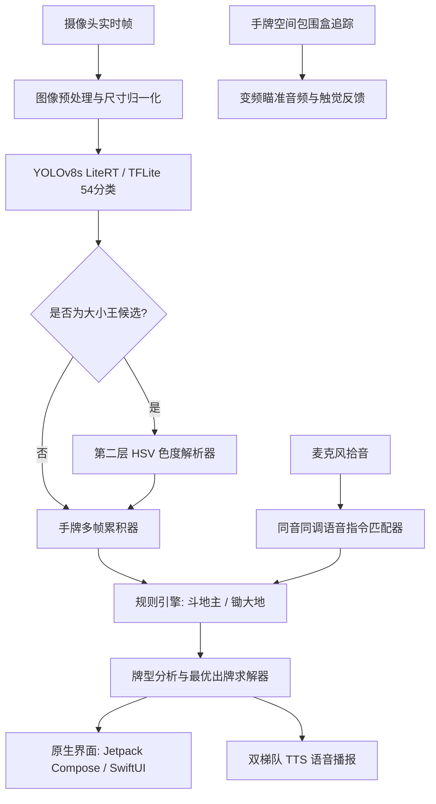

# 锄大地 / 斗地主 智能辅助与无障碍助手 (CDD & DDZ Helper)


**基于端侧计算机视觉与免提非视觉无障碍技术的「锄大地 (Big Two)」与「斗地主」智能算牌助手**

[English](README.md) | [中文说明](README_zh.md)

-blue.svg)


-red.svg)

---

## 📢 发布与分发说明 (Release & Distribution Notice)

> [!IMPORTANT]
> **预发布里程碑与分发策略说明**：
> - **当前发布状态**：本项目目前处于首发**预发布阶段 (Pre-release, `v0.1.0-beta`)**。
> - **Android 分发形式**：已在 GitHub Releases 中提供打包且已完成签名的安装文件（`androidApp-release.apk` 与 `androidApp-debug.apk`），支持在实体 Android 手机上直接下载、安装并进行测试体验。
> - **iOS 分发策略**：由于苹果生态对应用分发有严格的 App Store 上架及开发者证书签名限制，**iOS 版本暂不提供安装包（不提供 `.ipa`、TestFlight 公测安装或 App Store 下载）**。本项目提供**完整的 iOS 原生源代码、Xcode 工程文件及详尽的本地编译运行指南**。开发者与测试人员可使用 Mac 设备通过 Xcode 将应用编译并部署至 iOS 模拟器或个人 iPhone/iPad 上体验。

---

## 🌟 项目简介

**CDD & DDZ Helper** 是一款完全离线运行、注重无障碍体验与隐私保护的扑克牌智能识别与决策辅助应用。专为以下两大风靡华人世界的扑克游戏深度定制：
1. **锄大地 (Big Two / 大老二)**：支持 13 张完整手牌识别，提供**大陆规则**（同花 > 顺子）与**香港规则**（蛇大过同花）两种主流变体设定。
2. **斗地主 (Fight the Landlord)**：完整支持**农民 (17张)** 与 **地主 (20张)** 模式，覆盖炸弹、王炸（火箭）、飞机带翅膀等复杂牌型。

本应用创新融合了**端侧实时深度学习检测（YOLOv8s + LiteRT / TFLite）**、**第二层色度启发式大小王判别算法**、**全套牌型逻辑分析与出牌推荐引擎**、**粤语/普通话/英语三语同音容错语音控制**，以及专为视障或低视力人群设计的**音调变频瞄准提示与触觉震动反馈**。

---

## ✨ 核心功能亮点

### 👁️ 端侧毫秒级扑克牌检测
- **54 分类 YOLOv8s 深度神经网络**：精准检测 52 张标准扑克牌以及小王（Black Joker / 細鬼）与大王（Red Joker / 大鬼）。
- **密集扇形手牌数据增强 (In-Hand & Fan Augmentation)**：利用合成 CutMix 与重叠手牌扩增技术（覆盖 5 至 18 张手牌密集遮挡场景），攻克手牌握持时相互遮挡导致的漏检难题。
- **100% 本地运算与隐私安全**：基于 Google LiteRT / TFLite float32 引擎纯本地推理，无需任何云端连接，绝不上传或存储相机图像。

### 🛡️ 双层大小王防误判机制 (Two-Layer Joker Safeguard)
- **攻克痛点**：在暖色光（白炽灯、暖光台灯）环境下，小王纸面常反射偏黄偏橙色光，导致传统神经网络容易将小王误判为大王。
- **第一层（深度模型）**：YOLOv8s 输出候选框位置及初步置信度。
- **第二层（HSV 色度像素分析）**：通过自研的 `JokerChromaResolver` 算法实时提取候选区域内的颜色分布：
  - 严格区分**真实红墨水印迹**（色相 $342^\circ-360^\circ$ 及 $0^\circ-14^\circ$，饱和度 $\ge 0.28$）与**纸张暖光反射**（色相 $25^\circ-50^\circ$）。
  - 在彻底杜绝暖光误判的同时，100% 确保真实大王不会被误降级。

### 🎮 完备的游戏规则与最佳出牌决策引擎
- **斗地主**：
  - 全自动拆解并识别：单张、对子、三张、三带一、三带对、顺子、连对、飞机带翅膀、四带二、炸弹与王炸。
  - 动态适配农民（目标 17 张）与地主（目标 20 张）的手牌数量。
- **锄大地**：
  - 支持单张、对子、三条、顺子、同花、葫芦（三带对）、四条、同花顺。
  - 自由切换**大陆规则**与**香港规则**（如判断同花与顺子的大小关系）。
- **最优出牌推荐**：将当前锁定的手牌拆分为最优的合法牌型组合，并智能给出最推荐的首发/应手牌型。

### 🗣️ 免提三语语音控制 (ASR)
内置高容错同音同调语音指令匹配器（`VoiceCommandMatcher`），专为真实游戏环境中的嘈杂背景与多方言口语习惯设计：
- **粤语 (香港)**：支持「鎖定」、「鎖牌」、「定牌」、「得喇」、「搞掂」、「停牌」、「新一局」、「洗牌」、「再嚟」、「解鎖」、「睇牌」、「睇下有咩出」、「點樣出牌」、「轉模式」、「做地主」、「當農民」等。
- **普通话 (大陆)**：支持「锁定」、「锁牌」、「定牌」、「收牌」、「新一局」、「洗牌」、「解锁」、「重新开始」、「报牌」、「读牌」、「怎么出牌」、「出什么牌」、「切换斗地主」、「切换锄大地」、「当地主」、「当农民」等。
- **English (英语)**：支持 `lock`、`lock cards`、`new cards`、`new round`、`reset`、`read cards`、`what to play`、`switch mode`、`landlord`、`peasant` 等。

### 🔊 双梯队语音合成播报 (TTS)
- **第一梯队（原生引擎）**：iOS 采用系统原生 `AVSpeechSynthesizer`（粤语 Sin-ji、普通话 Ting-Ting 等高品质人声），Android 采用系统内置 TTS 引擎，纯离线极速响应。
- **第二梯队（云端备用）**：无缝降级至 Google Cloud TTS 神经网络语音。
- 播报语言自然贴切牌局习惯（例如：“一对2”、“三带二”、“黑桃顺子”、“王炸火箭”）。

### ♿ 非视觉瞄准指引与无障碍关怀
- **变频音调指引 (Audio Tone Guidance)**：当镜头移动让手牌逐步进入最佳扫描框正中央时，连续伴音音调将实时升频变尖锐，帮助盲人或弱视朋友轻松对准。
- **边界与锁定震动 (Haptic Feedback)**：手牌移入视野触发微震动，手牌数量集齐（13/17/20张）时发出清脆的三重确认震动。
- **实体物理按键支持**：
  - **音量减键 (Volume Down)**：一键锁定当前手牌；在已锁定时点击则清空并开启新一局重新扫描。
  - **音量加键 (Volume Up)**：随时触发语音完整报牌与推荐出牌方案。
- **无障碍手牌浏览器 (Hands Explorer)**：提供大字体、高对比度、清晰分组的无障碍卡牌列表弹窗。

### ⚙️ 设置持久化与环境自测
游戏模式、身份角色、规则变体、语音语言、语速、音调、音量、瞄准辅助与震动开关等所有设置均通过 `SharedPreferences` (Android) 及 `UserDefaults` (iOS) 自动保存，重启应用不丢失；并在设置页面配备了麦克风语音输入自测工具。

---

## 🏛️ 系统架构图



---

## 📁 代码工程目录

```
CDD_DDZ_Helper/
├── androidApp/                         # Android 应用工程外壳
│   ├── build.gradle.kts                # Android 构建配置 (compileSdk 36, Java 21)
│   └── src/
│       └── androidMain/                # Android 平台入口与 MainActivity
├── composeApp/                         # Kotlin Multiplatform (KMP) 跨平台核心模块
│   ├── build.gradle.kts                # KMP 依赖与编译定义
│   └── src/
│       ├── commonMain/                 # 跨平台共享业务代码
│       │   └── kotlin/com/example/demo/
│       │       ├── App.kt              # Compose Multiplatform 主界面与状态流
│       │       ├── domain/             # 卡牌模型、花色点数、设置数据结构
│       │       ├── guidance/           # 瞄准辅助变频音调与触觉状态机
│       │       ├── rules/              # 斗地主与锄大地牌型规则及手牌求解算法
│       │       ├── services/           # 语音指令匹配、卡牌报牌口令格式化
│       │       └── ui/                 # 设置页面、手牌探索弹窗、卡牌徽标
│       └── androidMain/                # Android 平台特化实现 (CameraX, LiteRT)
│           └── assets/card_model.tflite # Android 端打包的 float32 LiteRT 离线模型
├── iosApp/                             # Apple iOS 原生工程 (SwiftUI + UIKit)
│   ├── iosApp.xcodeproj                # Xcode 项目工程
│   └── iosApp/
│       ├── iOSApp.swift                # iOS 应用生命周期入口
│       ├── ContentView.swift           # 原生 SwiftUI 主界面（液态玻璃磨砂质感）
│       ├── SettingsView.swift          # 原生分组设置页面
│       ├── HandsExplorerView.swift     # 无障碍牌型详情弹窗
│       ├── CardModelLiteRT.swift       # TensorFlow Lite Swift 推理封装
│       ├── JokerChromaResolver.swift   # Swift 原生实现的 HSV 色度防误判算法
│       ├── GameRules.swift             # 斗地主与锄大地 Swift 规则引擎
│       ├── NativeSpeechEngine.swift    # AVSpeechSynthesizer 与 Google TTS 语音播报
│       ├── SpeechRecognitionService.swift # SFSpeechRecognizer 连续语音识别
│       ├── AudioHapticGuidance.swift   # AVAudioEngine 变频发生器与 CoreHaptics
│       └── card_model.tflite           # iOS Bundle 内嵌的 float32 LiteRT 离线模型
├── training/                           # 模型训练、数据扩增与转换管道
│   ├── augment_jokers.py               # 密集手牌 CutMix 与扇形遮挡数据合成脚本
│   ├── train_yolov8s.py                # YOLOv8s PyTorch 训练主脚本
│   ├── export_and_deploy.py            # ONNX 转 TFLite 并同步部署至各端资源目录
│   └── run_pipeline.bat                # Windows 一键全流程训练与 ADB 自动安装批处理
└── scripts/
    └── run_ios.sh                      # iOS 模拟器一键编译与启动测试脚本
```

---

## 🛠️ 安装、编译与运行指南

### 环境准备
- **Java 环境**：JDK 21（推荐使用 Eclipse Temurin 21 或 OpenJDK 21）
- **Android 环境**：Android SDK 36、Build-Tools 36.0.0、ADB
- **iOS 编译环境**：运行 macOS 系统的 Mac 电脑，已安装 Xcode 16+（Swift 5.9+，最低部署目标 iOS 17.0+）
- **模型训练环境（仅限需要二次训练者）**：Python 3.10+、CUDA 12+ GPU、PyTorch、Ultralytics、`onnx2tf`

---

### 🤖 Android 编译与安装

#### 1. 直接安装预发布 APK（测试用户首选）
从本仓库的 Releases 页面下载已完成签名的 **`androidApp-release.apk`**，通过 ADB 命令安装到连接的手机：
```shell
adb install -r androidApp-release.apk
```

#### 2. 从源码编译 APK
克隆本仓库到本地，在项目根目录下通过 Gradle 编译：

- **Windows 控制台 / PowerShell**：
  ```shell
  # 编译签名 Release APK:
  .\gradlew.bat :androidApp:assembleRelease

  # 或编译 Debug APK:
  .\gradlew.bat :androidApp:assembleDebug
  ```
- **macOS / Linux 终端**：
  ```shell
  ./gradlew :androidApp:assembleRelease
  ```

编译生成的 APK 位于：
```
androidApp/build/outputs/apk/release/androidApp-release.apk
```

使用 ADB 直接将新编译好的 APK 安装并启动：
```shell
adb install -r androidApp/build/outputs/apk/release/androidApp-release.apk
adb shell am start -n com.example.cddddzhelper/.MainActivity
```

---

### 🍏 iOS 本地编译与运行指南

> [!NOTE]
> **为什么没有直接提供 iOS 安装包？**
> 如前文[发布与分发说明](#-发布与分发说明-release--distribution-notice)所述，iOS 应用的分发依赖苹果 App Store 审查认证。因此预发布版本不提供二进制安装文件，请参考以下方式在本地 Mac 上编译运行：

#### 方案 A：使用命令行脚本运行模拟器
1. 确保安装了 Xcode 命令行工具：
   ```shell
   xcode-select --install
   ```
2. 进入工程根目录，执行自动化构建脚本：
   ```shell
   chmod +x scripts/run_ios.sh
   ./scripts/run_ios.sh
   ```
   *该脚本会自动唤醒可用的 iPhone 模拟器（如 iPhone 16），编译 iOS 原生工程，自动安装并拉起应用。*

#### 方案 B：在 Xcode 中打开并部署到实体 iPhone
1. 使用 Xcode 打开项目：
   ```shell
   open iosApp/iosApp.xcodeproj
   ```
2. 在 Xcode 界面中：
   - 顶部运行目标（Run Destination）选择您的 iPhone 或模拟器。
   - 若部署到实体 iPhone，点击左侧工程根节点，切换到 **Signing & Capabilities** 标签页，在 **Team** 下登录并勾选您的个人 Apple ID（Personal Team）。
   - 按下快捷键 **Cmd + R**（或点击左上角三角形运行按钮），Xcode 将自动编译并在设备上启动应用。

---

### 🧠 模型训练与自动化流水线

项目包含一套全自动化的闭环流水线，实现从手牌合成扩增、模型训练、ONNX 转换、TFLite 部署到实体机自动刷入：

在 Windows 环境下运行：
```shell
cd training
.\run_pipeline.bat
```

该批处理将依次执行 4 个步骤：
1. `augment_jokers.py`：对 5~18 张密集手牌进行 CutMix 与扇形重叠增强，生成超 1,100 张均衡样本；
2. `train_yolov8s.py`：利用 GPU 进行 50 个 Epoch 的迁移学习训练；
3. `export_and_deploy.py`：利用 `onnx2tf` 转换为高兼容的 float32 TFLite 模型，自动覆盖部署到 Android (`composeApp/src/androidMain/assets/card_model.tflite`) 与 iOS (`iosApp/iosApp/card_model.tflite`)；
4. **实体设备检测与安装**：自动检测当前通过 USB 调试连接的 Android 实体机，直接通过 ADB 升级安装并启动最新应用。

---

## 🎙️ 语音指令对照速查表

| 操作意图 | 粤语口语 (`zh-HK`) | 普通话口语 (`zh-CN`) | 英语 (`en-US`) |
| :--- | :--- | :--- | :--- |
| **锁定手牌** | 鎖定、鎖牌、定牌、得喇、搞掂、停牌 | 锁定、锁牌、定牌、收牌 | `lock`, `lock cards`, `lock hand` |
| **开新局 / 解锁** | 新一局、洗牌、重開、再嚟、解鎖、重新發牌 | 新一局、洗牌、解锁、重新开始、重新扫描 | `new cards`, `new round`, `reset`, `unlock` |
| **报牌 / 询问出牌** | 睇牌、報牌、讀牌、講下牌、有咩出、點樣出牌 | 报牌、读牌、看牌、怎么出、出什么牌 | `read cards`, `report`, `what to play` |
| **切换游戏模式** | 轉模式、切換模式、換玩法 | 切换模式、换模式、切换玩法 | `switch mode`, `change game` |
| **切换至锄大地** | 轉做鋤大D、玩大老二、切換到鋤大地 | 切换到锄大地、玩大老二、锄大D | `switch to big two`, `play cdd` |
| **切换至斗地主** | 轉做鬥地主、玩鬥地主、切換到鬥地主 | 切换到斗地主、玩斗地主 | `switch to doudizhu`, `play ddz` |
| **切换角色身份** | 轉角色、換身分 | 切换身份、换角色 | `switch role`, `change role` |
| **选择地主身份** | 我係地主、做地主、搶地主 | 当地主、我是地主、叫地主、抢地主 | `landlord`, `switch to landlord` |
| **选择农民身份** | 我係農民、做農民、唔叫 | 当农民、我是农民、不叫、不抢 | `peasant`, `farmer`, `switch to peasant` |

---

## 🎛️ 物理按键与无障碍操作说明

- **音量减键 (Volume Down)**：
  - 扫描中：**锁定**当前识别到的所有手牌；
  - 已锁定时：**解锁并重置**，清空手牌以迎接新一局扫描。
- **音量加键 (Volume Up)**：
  - 随时呼叫**语音完整播报**，语音朗读当前手牌组成与最优推荐出牌。
- **音频瞄准指引 (Audio Guidance)**：
  - 手牌进入画面中心时音调随之变高；
  - 牌数凑齐时发出确认短音。
- **触觉震动反馈 (Haptics)**：
  - 边缘对齐时轻微震动；
  - 凑齐 13/17/20 张完整手牌时产生清晰的三重连震。

---

## 📄 开源许可证与声明

本项目基于 Apache 2.0 许可证开源，详情参见 [LICENSE](LICENSE) 文件。

*免责声明：本软件仅作为辅助娱乐与无障碍便利工具，供个人技术交流与研究学习使用。扑克牌及相关游戏图案知识产权归其版权所有方所有。*
